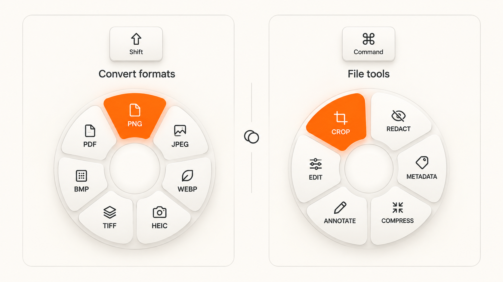

<div align="center">
  
  <h1>MacMove for macOS</h1>
  <p><strong>Tool by Oasis</strong><br>A native Mac menu bar app for image conversion, PDF tools, media editing, and everyday file utilities.</p>
  <p><strong>macOS 26+</strong> · Local processing · GPL-3.0-only</p>
</div>

<p align="center"><a href="https://oasis.upfaast.com/">Website</a> · <a href="https://github.com/Giridharnandi/MacMove-By-Oasis/releases">Downloads</a> · <a href="privacy.md">Privacy policy</a> · <a href="SECURITY.md">Security</a></p>

<p align="center">
  <a href="https://github.com/Giridharnandi/MacMove-By-Oasis/releases/download/v0.2.0/MacMove-0.2.0-macOS.pkg"></a>
</p>

If MacMove is useful in your workflow, [star the repository](https://github.com/Giridharnandi/MacMove-By-Oasis) to help more Mac users discover it.

## A calmer way to work with files on Mac

MacMove is an open-source macOS file utility that brings an image converter, PDF tools, media editing, and file actions into one menu bar app. Drag files or use a keyboard shortcut to open the right tool, then process files locally on your Mac.



*Illustrative product graphic. The controls and labels show the tool families; this is not a live app screenshot.*

## Mac image conversion, PDF tools, media editing, and file actions

- **Convert images** across PNG, JPEG, HEIC, TIFF, BMP, WebP, AVIF and SVG input routes.
- **Work with PDFs and documents**: create, merge, split, reorder pages, and export PDF content to text, images or DOCX.
- **Edit media** with tools for trimming, splitting, joining, cropping, speed changes, snapshots and audio adjustments.
- **Handle files**: reveal, copy, duplicate, copy paths and calculate SHA-256 checksums.
- **Process batches** with separate outputs and progress for each file.

Many audio, video and codec operations require optional FFmpeg. MacMove does not silently install it.

## Download and install

Download the [MacMove 0.2.0 macOS installer (.pkg)](https://github.com/Giridharnandi/MacMove-By-Oasis/releases/download/v0.2.0/MacMove-0.2.0-macOS.pkg), open it, and follow the Installer steps. Then launch MacMove from Applications. This unsigned build may trigger a macOS security warning or require approval before opening.

The app targets **macOS 26 or later**. This trial is for **Apple silicon**; Intel compatibility has not been verified. Some media features need a separately installed FFmpeg build.

## Use MacMove

MacMove lives in the menu bar. Select files in Finder, then:

1. Drag while holding **Shift** to convert a selection to a common format.
2. Hold **Command** while dragging to open the tool wheel.
3. Hold **Control** while dragging for file actions.
4. Use the menu-bar commands if a drag shortcut is unavailable.

Outputs go beside the source by default. Change the destination in Settings. Start with copies of important files and review exported results.

## Build from source

Building requires a Mac with macOS 26 or later, Xcode 26 or compatible Command Line Tools, and Git.

```sh
git clone https://github.com/Giridharnandi/MacMove-By-Oasis.git MacMove
cd MacMove
./scripts/build-app.sh
open "dist/MacMove.app"
```

To install a local build, move `dist/MacMove.app` to Applications in Finder. Local builds are ad-hoc signed and not notarized.

## Privacy and limitations

Files are processed locally; the app has no account system or app analytics. Update checks contact GitHub. Optional website analytics run only after consent. Read the [privacy policy](privacy.md) or view it on the [MacMove website](https://oasis.upfaast.com/#privacy).

This is an early trial. Not every format route has been verified, archive conversion is disabled, and native image input is limited to 100 MB and 40 megapixels. Metadata editing and visible redaction are not certified anonymization. See [known limitations](docs/BUILD-STATUS.md).

## License and attribution

MacMove by Oasis additions are licensed under **GPL-3.0-only**. Upstream Satsuma code remains under its original MIT license; notices are included in the app and repository. See [LICENSE](LICENSE) and [third-party notices](THIRD_PARTY_NOTICES.md).

